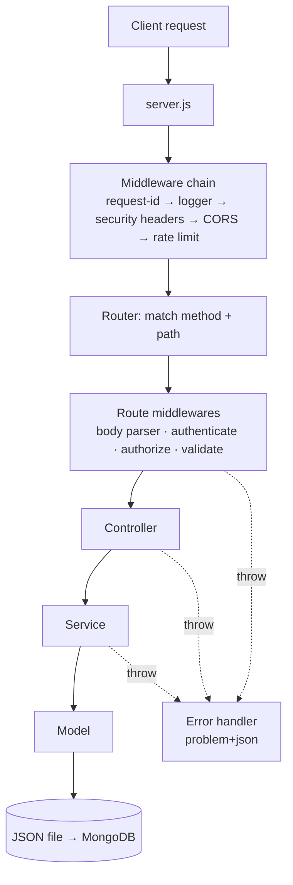

# pure-node-shop — Project Plan

Mini e-commerce REST API in pure Node.js (no framework), built module by module
to learn how backend frameworks work underneath. Rules and conventions live in
`CLAUDE.md`; this file is the **what** and **in which order**.

---

## 1. Scope

| Area | Included |
|---|---|
| Runtime | Node 24/26 LTS, ESM, `--watch`, `--env-file` |
| Core | Router, params/query, JSON body parser, middleware chain, RFC 9457 errors, validator |
| Ops | Structured logger + request ID, CORS, security headers, rate limit, `/health`, graceful shutdown |
| Auth | Argon2id (built-in), custom JWT (learning), role guard + ownership check |
| Modules | User, Product (pagination/search/filter/sort), Cart, Order |
| Data | JSON-file store → MongoDB native driver v7.9+ (same model interface) |
| Testing | `node:test` + native `fetch` |

**Out of scope:** file upload, real-time (SSE/WebSocket), email/background jobs,
payment gateway, caching/Redis, frontend. Output is a REST API only.

## 2. Folder structure

```
pure-node-shop/
├── CLAUDE.md
├── docs/PROJECT_PLAN.md
├── .env.example
├── .gitignore
├── package.json
├── playground/                 # old experiments, reference only (not part of the app)
├── scripts/
│   └── seed-admin.js           # `npm run seed:admin` (M7)
├── data/                       # JSON-file DB (Phase 2–3)
│   ├── users.json
│   ├── products.json
│   ├── carts.json
│   └── orders.json
├── src/
│   ├── server.js               # create server, connect DB, listen, graceful shutdown
│   ├── app.js                  # middleware chain + router + error handler
│   ├── routes.js               # mount all module routes under /api/v1
│   ├── config/
│   │   └── env.js
│   ├── core/
│   │   ├── router.js
│   │   ├── compose.js
│   │   ├── body-parser.js
│   │   ├── response.js
│   │   ├── app-error.js
│   │   ├── error-handler.js
│   │   └── validator.js
│   ├── middlewares/
│   │   ├── request-id.js
│   │   ├── logger.js
│   │   ├── security-headers.js
│   │   ├── cors.js
│   │   ├── rate-limit.js
│   │   └── auth.js             # authenticate, authorize(...roles)
│   ├── db/
│   │   ├── json-store.js       # Phase 2
│   │   └── mongo.js            # Phase 4
│   ├── utils/
│   │   ├── password.js
│   │   ├── jwt.js
│   │   └── pagination.js
│   └── modules/
│       ├── health/health.route.js
│       ├── user/      user.{model,service,controller,route,validation}.js
│       ├── product/   product.{model,service,controller,route,validation}.js
│       ├── cart/      cart.{model,service,controller,route,validation}.js
│       └── order/     order.{model,service,controller,route,validation}.js
└── test/
    ├── health.test.js
    ├── auth.test.js
    └── order.test.js
```

## 3. Request lifecycle



Middleware order matters: request ID first (so every log/error has it), logger
second (so it measures everything), rate limit before any expensive work, body
parsing only on routes that need a body.

## 4. Environment variables

| Name | Example | Used from |
|---|---|---|
| `NODE_ENV` | `development` | M0 |
| `PORT` | `8000` | M0 |
| `BODY_LIMIT_BYTES` | `1048576` | M3 |
| `DATA_DIR` | `./data` | M6 |
| `JWT_SECRET` | 32+ random bytes (hex) | M7 |
| `JWT_EXPIRES_IN` | `900` (seconds) | M7 |
| `ADMIN_EMAIL` | `admin@example.com` | M7 (seed script) |
| `ADMIN_PASSWORD` | 15+ chars | M7 (seed script) |
| `CORS_ORIGINS` | `http://localhost:3000` | M11 |
| `RATE_LIMIT_WINDOW_MS` | `60000` | M11 |
| `RATE_LIMIT_MAX` | `100` | M11 |
| `MONGODB_URI` | `mongodb://localhost:27017` | M12 |
| `MONGODB_DB` | `pure_node_shop` | M12 |

## 5. Data models

```js
// User
{ id, name, email /* unique, lowercase */, passwordHash, role /* 'customer' | 'admin' */, createdAt, updatedAt }

// Product
{ id, name, description, price /* int, paisa */, stock /* int ≥ 0 */, category, imageUrl, isActive, deletedAt /* null unless soft-deleted */, createdAt, updatedAt }

// Cart (one per user)
{ id, userId, items: [{ productId, quantity }], updatedAt }

// Order (prices are a snapshot at order time)
{ id, userId,
  items: [{ productId, name, unitPrice, quantity, lineTotal }],
  totalAmount, status, createdAt, updatedAt }
```

Order status transitions (anything else → 422):

```
pending → paid → shipped → delivered
pending → cancelled
paid    → cancelled
```

## 6. API endpoints (`/api/v1`)

| Method | Path | Auth | Description |
|---|---|---|---|
| GET | `/health` | — | Liveness check (`{ status, uptime }`) |
| POST | `/auth/register` | — | Create customer account |
| POST | `/auth/login` | — | Returns `{ accessToken, user }` |
| GET | `/users/me` | user | Current user profile |
| GET | `/products` | — | List: `?page&limit&q&category&minPrice&maxPrice&sort` (active only; admin may add `includeInactive=true`) |
| GET | `/products/:id` | — | Single product (inactive → 404 for non-admin) |
| POST | `/products` | admin | Create product |
| PATCH | `/products/:id` | admin | Update product |
| DELETE | `/products/:id` | admin | Soft delete: `isActive=false` + `deletedAt` (204) |
| GET | `/cart` | user | Own cart with computed totals |
| POST | `/cart/items` | user | Add `{ productId, quantity }` |
| PATCH | `/cart/items/:productId` | user | Set quantity |
| DELETE | `/cart/items/:productId` | user | Remove item |
| DELETE | `/cart` | user | Clear cart |
| POST | `/orders` | user | Create order from cart (stock check + decrement, clears cart) |
| GET | `/orders` | user / admin | Own orders (admin: all, paginated) |
| GET | `/orders/:id` | owner / admin | Single order |
| PATCH | `/orders/:id/status` | admin | Change status (validated transitions) |
| POST | `/orders/:id/cancel` | owner | Cancel own `pending` order (restock) |

`sort` format: `price`, `-price`, `createdAt`, `-createdAt` (allowlist only).
`limit` default 20, max 100.

## 7. Module syllabus

Each module: **Learn → Build → Done when → Resources**. Confirm each one before
starting the next.

### Phase 1 — Foundation (your own mini framework)

#### M0. Setup & tooling
- **Learn:** `package.json`, `"type": "module"`, `engines`, npm scripts, `--watch`, `--env-file`
- **Build:** `package.json`, `.env.example`, `.gitignore`, `src/config/env.js` (fail fast on missing env)
- **Done when:** `npm run dev` starts the server and restarts on save; missing required env crashes with a clear message
- **Resources:** [Node packages (ESM)](https://nodejs.org/api/packages.html) · [Environment variables](https://nodejs.org/api/environment_variables.html) · [CLI options](https://nodejs.org/api/cli.html)

#### M1. HTTP deep dive + response helpers
- **Learn:** `IncomingMessage` / `ServerResponse`, status codes, headers, `server.js` vs `app.js` split
- **Build:** `src/server.js`, `src/app.js`, `src/core/response.js` (`sendJson`)
- **Done when:** `GET /` returns JSON with correct `Content-Type` and status
- **Resources:** [Node http](https://nodejs.org/api/http.html) · [MDN: HTTP overview](https://developer.mozilla.org/en-US/docs/Web/HTTP/Overview) · [MDN: Status codes](https://developer.mozilla.org/en-US/docs/Web/HTTP/Status)

#### M2. Router
- **Learn:** `URL` / `URLSearchParams`, method + path matching, `/:id` params, 404 vs 405
- **Build:** `src/core/router.js`, `src/routes.js` (`/api/v1`), `src/modules/health/health.route.js`
- **Done when:** `/api/v1/health` → 200; unknown path → 404; wrong method → 405 with `Allow`
- **Resources:** [Node URL](https://nodejs.org/api/url.html) · [MDN: URLSearchParams](https://developer.mozilla.org/en-US/docs/Web/API/URLSearchParams) · [MDN: 405](https://developer.mozilla.org/en-US/docs/Web/HTTP/Status/405)

#### M3. Body parser
- **Learn:** streams, Buffers, chunks, `for await` over a stream, size limits
- **Build:** `src/core/body-parser.js`
- **Done when:** valid JSON parsed; bad JSON → 400; wrong `Content-Type` → 415; too large → 413
- **Resources:** [Node stream](https://nodejs.org/api/stream.html) · [Node buffer](https://nodejs.org/api/buffer.html) · [Anatomy of an HTTP transaction](https://nodejs.org/en/learn/modules/anatomy-of-an-http-transaction)

#### M4. Middleware pipeline
- **Learn:** the `next()` pattern, async middleware, why order matters
- **Build:** `src/core/compose.js`, `src/middlewares/request-id.js`, `src/middlewares/logger.js`
- **Done when:** every response has `X-Request-Id`; one structured JSON log line per request with duration
- **Resources:** [Node crypto](https://nodejs.org/api/crypto.html) · [Node perf_hooks](https://nodejs.org/api/perf_hooks.html) · [koa-compose source](https://github.com/koajs/compose)

#### M5. Errors & validation
- **Learn:** custom Error classes, throw vs return, catching async errors, RFC 9457
- **Build:** `src/core/app-error.js`, `src/core/error-handler.js`, `src/core/validator.js`
- **Done when:** all errors return `application/problem+json`; unknown errors → 500 without stack trace
- **Resources:** [RFC 9457](https://www.rfc-editor.org/rfc/rfc9457) · [MDN: Error](https://developer.mozilla.org/en-US/docs/Web/JavaScript/Reference/Global_Objects/Error) · [OWASP Error Handling](https://cheatsheetseries.owasp.org/cheatsheets/Error_Handling_Cheat_Sheet.html)

### Phase 2 — Data layer

#### M6. JSON-file store
- **Learn:** `fs/promises`, atomic write (temp file + rename), write queue to avoid races
- **Build:** `src/db/json-store.js` — `findAll`, `findById`, `findOne`, `insert`, `update`, `remove`
- **Done when:** 10 concurrent writes never corrupt the file
- **Resources:** [Node fs](https://nodejs.org/api/fs.html) · [Node path](https://nodejs.org/api/path.html)

### Phase 3 — Features

#### M7. User + auth
- **Learn:** why Argon2id, JWT structure, HMAC, timing attacks
- **Build:** `src/utils/password.js`, `src/utils/jwt.js`, `src/middlewares/auth.js` (`authenticate`), user module (register, login, `/users/me`), `scripts/seed-admin.js` (idempotent, reads `ADMIN_EMAIL`/`ADMIN_PASSWORD`)
- **Done when:** login returns a token; `/users/me` without token → 401; only hashes stored; duplicate email → 409
- **Resources:** [Node crypto](https://nodejs.org/api/crypto.html) · [OWASP Password Storage](https://cheatsheetseries.owasp.org/cheatsheets/Password_Storage_Cheat_Sheet.html) · [RFC 7519 (JWT)](https://www.rfc-editor.org/rfc/rfc7519) · [jwt.io intro](https://jwt.io/introduction) · [jose (production)](https://github.com/panva/jose)

#### M8. Product
- **Learn:** role-based authorization, pagination with a cap, search/filter/sort allowlists, money as integers
- **Build:** `authorize(...roles)`, `src/utils/pagination.js`, product module
- **Done when:** non-admin writes → 403; `?page=2&limit=10&sort=-price&q=shirt` works; `meta` is correct
- **Resources:** [OWASP Authorization](https://cheatsheetseries.owasp.org/cheatsheets/Authorization_Cheat_Sheet.html) · [MDN: Array.prototype.sort](https://developer.mozilla.org/en-US/docs/Web/JavaScript/Reference/Global_Objects/Array/sort)

#### M9. Cart
- **Learn:** ownership checks (BOLA/IDOR), quantity validation, stock checks
- **Build:** cart module
- **Done when:** a user can never read or modify another user's cart; quantity > stock → 409
- **Resources:** [OWASP API Security Top 10 (2023)](https://owasp.org/API-Security/editions/2023/en/0x11-t10/) · [OWASP IDOR Prevention](https://cheatsheetseries.owasp.org/cheatsheets/Insecure_Direct_Object_Reference_Prevention_Cheat_Sheet.html)

#### M10. Order
- **Learn:** cart → order, price snapshot, stock decrement, status state machine
- **Build:** order module
- **Done when:** over-stock → 409; invalid transition → 422; users see only their own orders; cancel restocks
- **Resources:** [MDN: 409](https://developer.mozilla.org/en-US/docs/Web/HTTP/Status/409) · [MDN: 422](https://developer.mozilla.org/en-US/docs/Web/HTTP/Status/422)

### Phase 4 — Production-ready

#### M11. Security & ops
- **Learn:** CORS preflight, security headers, fixed-window rate limiting, graceful shutdown
- **Build:** `security-headers.js`, `cors.js`, `rate-limit.js`, shutdown logic in `server.js`
- **Done when:** over limit → 429 + `Retry-After`; `OPTIONS` preflight answered; Ctrl+C finishes in-flight requests before exit
- **Resources:** [MDN: CORS](https://developer.mozilla.org/en-US/docs/Web/HTTP/CORS) · [OWASP HTTP Headers](https://cheatsheetseries.owasp.org/cheatsheets/HTTP_Headers_Cheat_Sheet.html) · [OWASP REST Security](https://cheatsheetseries.owasp.org/cheatsheets/REST_Security_Cheat_Sheet.html) · [MDN: 429](https://developer.mozilla.org/en-US/docs/Web/HTTP/Status/429) · [Node process signals](https://nodejs.org/api/process.html#signal-events)

#### M12. MongoDB migration
- **Learn:** native driver, connection pooling, `ObjectId`, indexes (unique email), atomic conditional `$inc`
- **Build:** `src/db/mongo.js`, rewrite each `*.model.js` only; connect DB before `listen`
- **Done when:** every endpoint behaves exactly as before, data now in MongoDB
- **Resources:** [MongoDB Node.js Driver](https://www.mongodb.com/docs/drivers/node/current/) · [Driver release notes](https://www.mongodb.com/docs/drivers/node/current/reference/release-notes/) · [$inc operator](https://www.mongodb.com/docs/manual/reference/operator/update/inc/)

#### M13. Testing
- **Learn:** `node:test`, `assert`, starting a test server, API tests with `fetch`
- **Build:** `test/health.test.js`, `test/auth.test.js`, `test/order.test.js`
- **Done when:** `npm test` passes
- **Resources:** [Node test runner](https://nodejs.org/api/test.html) · [Node assert](https://nodejs.org/api/assert.html) · [MDN: Fetch API](https://developer.mozilla.org/en-US/docs/Web/API/Fetch_API)

## 8. Decisions

- **Admin:** only via `npm run seed:admin` (idempotent). `register` always creates `customer`.
- **Products:** non-admin sees only `isActive: true`. DELETE is soft. Old orders unaffected (price snapshot).
- **Cart:** stock checked on add (UX only) and again at order time (authoritative, atomic).
- **Order creation:** inactive/deleted product or insufficient stock → 409 with `errors[].pointer` like `#/items/2`. Never silently skip.
- **Cancel:** any cancel restocks. Owner may cancel only `pending`; admin may cancel `pending` or `paid` via PATCH. Refund is out of scope (note in code).
- **Auth:** access token only, 15 min (`JWT_EXPIRES_IN=900`). Refresh token optional, after core is done.
- **Input:** email trimmed + lowercased, max 254, pragmatic regex. Password min 15, max 128, no composition rules, Unicode allowed (NIST SP 800-63B-4, no MFA).
- **Logging:** one JSON line to stdout: `time, level, requestId, method, path, status, durationMs`. Errors: `level: "error"` + message; stack only in logs.
- **Tests:** `listen(0)`, temp `DATA_DIR` per test file via `fs.mkdtemp`, cleaned in `after()`. After M12 use `pure_node_shop_test`.
- **Argon2:** verify `crypto.argon2` stability in Node docs before M7; otherwise scrypt fallback, state the reason.

## 9. Definition of done (every module)

1. Syllabus explained and understood (function relationships + data flow)
2. Code typed by the developer, following `CLAUDE.md` rules
3. All "Done when" checks pass manually
4. No rule violations (layers, error format, no frameworks)
5. Progress checkbox in `CLAUDE.md` ticked
